Drift Monitoring
================

Overview
--------

The Drift Monitoring domain documents the database structures used to
represent drift detectors, detector packs, experiment-level detector
configuration, and drift results associated with runs.

The diagram distinguishes detector definitions from their packaging,
experiment configuration, and recorded monitoring results.

Entity-Relationship Diagram
---------------------------

The following diagram presents the main entities associated with
Drift Monitoring.

Entities and Responsibilities
-----------------------------

DRIFT_DETECTORS
~~~~~~~~~~~~~~~

The ``DRIFT_DETECTORS`` entity stores drift-detector definitions.

Its fields include:

* ``id`` and ``detector_id``.
* ``name`` and ``kind``.
* ``description``.
* ``params``.
* ``enabled``.
* ``created_at``.

The ``params`` field stores detector parameter information.

DETECTOR_PACKS
~~~~~~~~~~~~~~

The ``DETECTOR_PACKS`` entity represents versioned detector packs.

Its fields include:

* **Identity:** ``id``, ``name``, and ``version``.
* **Source and storage:** ``source`` and ``storage_path``.
* **Contents:** ``detector_count`` and ``detectors``.
* **Status:** ``is_active``.
* **Additional metadata:** ``notes``, ``created_by``, and ``created_at``.

The diagram therefore distinguishes the detector pack from the
individual detector definitions represented by ``DRIFT_DETECTORS``.

EXPERIMENT_DRIFT_DETECTORS
~~~~~~~~~~~~~~~~~~~~~~~~~~

The ``EXPERIMENT_DRIFT_DETECTORS`` entity stores experiment-level
detector configuration.

Its fields include:

* ``experiment_id`` and ``detector_id``.
* ``variables``.
* ``phase``.
* ``params_override``.
* ``enabled``.
* ``created_by`` and ``created_at``.

These fields describe the detector identifier and configuration
associated with an experiment, including variables, phase information,
and parameter overrides.

DRIFT_RESULTS
~~~~~~~~~~~~~

The ``DRIFT_RESULTS`` entity stores results associated with drift
monitoring.

Its fields include:

* ``run_id`` and ``detector_id``.
* ``variable`` and ``phase``.
* ``result_type``.
* ``score`` and ``drift``.
* ``details`` and ``pack_version``.
* ``computed_at`` and ``created_at``.

The ``score``, ``drift``, and ``details`` fields provide the documented
result information, while the timestamps record computation and creation
times.

Key Relationships
-----------------

The diagram depicts the following relationships and references:

* ``EXPERIMENT_DRIFT_DETECTORS`` includes an ``experiment_id`` foreign
  key and detector configuration fields.
* ``DRIFT_RESULTS`` includes a ``run_id`` foreign key and records
  detector identifiers, variables, phases, and result information.
* ``DETECTOR_PACKS`` includes the ``created_by`` foreign key.
* ``DRIFT_DETECTORS`` stores detector definitions and their configuration
  parameters.

The ``detector_id`` fields identify detectors in configuration and result
records. The diagram should be consulted when determining which
relationships are explicitly represented as database foreign keys.

Scope and Interpretation
------------------------

This page documents the entities and fields represented in the supplied
Drift Monitoring diagram.

Other entities referenced by the domain, including experiments, runs,
and users, are shown in the complete ERD or documented in their respective
database domains.

For a view of the complete database structure, see:

:doc:`Full Entity-Relationship Diagram <full-erd>`