Federated Learning
==================

Overview
--------

The Federated Learning domain documents the database structures used to
represent federations, participating projects, federation rounds, and
model contributions.

The diagram separates the federation itself from its participants,
round-level execution information, and contributions associated with
models.

Entity-Relationship Diagram
---------------------------

The following diagram presents the main entities and relationships
included in the Federated Learning domain.

Entities and Responsibilities
-----------------------------

FEDERATIONS
~~~~~~~~~~~

The ``FEDERATIONS`` entity stores the main configuration and status
of a federation.

Its fields include:

* **Identity:** ``id``, ``slug``, ``name``, and ``description``.
* **Coordination:** ``coordinator_org_id`` and
  ``current_global_model_id``.
* **Aggregation:** ``aggregation_strategy``.
* **Privacy:** ``privacy_mechanism`` and ``privacy_params``.
* **Execution status:** ``rounds_planned``, ``rounds_completed``,
  and ``status``.
* **Additional metadata:** ``notes``, ``tags``, ``created_at``,
  ``updated_at``, and ``created_by_user_id``.

FEDERATION_PARTICIPANTS
~~~~~~~~~~~~~~~~~~~~~~~

The ``FEDERATION_PARTICIPANTS`` entity represents projects participating
in a federation.

Its fields include:

* ``federation_id`` and ``project_id``.
* ``role``.
* ``joined_at`` and ``left_at``.
* ``local_dataset_size`` and ``local_data_hash``.
* ``last_contribution_round``.

These fields record participation, membership periods, local dataset
information, and contribution progress.

FEDERATION_ROUNDS
~~~~~~~~~~~~~~~~~

The ``FEDERATION_ROUNDS`` entity records round-level federation
information.

Its fields include:

* ``federation_id`` and ``round_number``.
* ``status``.
* ``global_metric_name`` and ``global_metric_value``.
* ``participants_expected`` and ``participants_received``.
* ``contributions``.
* ``global_model_id``.
* ``started_at``, ``aggregated_at``, and ``created_at``.

These attributes describe the execution status and aggregation results
associated with a federation round.

MODEL_CONTRIBUTIONS
~~~~~~~~~~~~~~~~~~~

The ``MODEL_CONTRIBUTIONS`` entity records model contributions associated
with a federation and round.

Its fields include:

* ``aggregated_model_id``.
* ``contributor_model_id``.
* ``federation_id``.
* ``round_number``.
* ``contribution_weight``.
* ``contribution_metrics``.
* ``created_at``.

Key Relationships
-----------------

The diagram depicts these main relationships:

* ``FEDERATION_PARTICIPANTS`` associates federations with projects.
* ``FEDERATION_ROUNDS`` associates round records with federations.
* ``MODEL_CONTRIBUTIONS`` associates contributor and aggregated model
  identifiers with a federation and round.
* ``FEDERATIONS`` contains references to a coordinating organization,
  a current global model, and the user who created the federation.
* ``FEDERATION_ROUNDS`` contains a reference to the global model
  associated with a round.

The model identifiers in these entities connect the federated-learning
domain with model information represented elsewhere in the database.

Scope and Interpretation
------------------------

This page documents the entities and fields represented in the supplied
Federated Learning diagram.

The diagram is a focused view. Related organizations, projects, users,
and model entities may be documented in other domains.

For a view of the complete database structure, see:

:doc:`Full Entity-Relationship Diagram <full-erd>`