Full Entity-Relationship Diagram
================================

Overview
--------

The Full Entity-Relationship Diagram (ERD) presents the database
entities and relationships represented in the supplied Model Registry
diagram.

Unlike the focused domain diagrams, the full ERD brings together the
main structures for model governance, federated learning, drift
monitoring, identity and access control, organizational hierarchy,
bioprocess execution, time-series storage, and operations and audit.

Complete Entity-Relationship Diagram
------------------------------------

The following diagram provides the complete database overview represented
by the supplied ERD.

.. note::

   The complete ERD is a large diagram. Click the image to open the
   interactive zoom viewer. Use the mouse wheel to zoom, drag to move
   around the diagram, and press ``Esc`` to close the viewer.

How to Read the Diagram
-----------------------

The diagram displays tables as entities and identifies important
columns and relationships.

Primary Keys
~~~~~~~~~~~~

A field marked ``PK`` belongs to the primary key of its table.

For the time-series entities, the primary key is composite and includes
the time field and the associated run and sensor, actuator, or
soft-sensor identifier.

Foreign Keys
~~~~~~~~~~~~

A field marked ``FK`` represents a foreign-key relationship shown
in the diagram.

Foreign-key fields indicate how records reference related entities.

Association Entities
~~~~~~~~~~~~~~~~~~~~

Some relationships are represented using association entities rather
than by storing a relationship directly in one of the main entities.

Examples shown in the diagram include:

* ``PROJECT_SOFT_SENSORS``
* ``EXPERIMENT_SOFT_SENSORS``
* ``PROJECT_DYNAMIC_MODELS``
* ``FEDERATION_PARTICIPANTS``
* ``MODEL_CONTRIBUTIONS``
* ``ROLE_PERMISSION``
* ``USER_ROLE``
* ``ORGANIZATIONS_DEPARTMENTS``
* ``DEPARTMENT_LABORATORY``
* ``LABORATORY_USER``
* ``LABORATORY_PROJECT``
* ``LABORATORY_EQUIPMENTS``
* ``EXPERIMENTS_EQUIPMENTS``
* ``EQUIPMENT_COMPONENTS``
* ``BIOREACTOR_INSTRUMENTS``

These tables represent associations between their related entities
and may also contain fields describing the association.

Database Domains
----------------

The focused documentation is organized into the following domains.

Model Governance
~~~~~~~~~~~~~~~~

Documents registered soft sensors, model metadata, model associations,
metrics, and dynamic models.

:doc:`Open Model Governance <model-governance>`

Federated Learning
~~~~~~~~~~~~~~~~~~

Documents federations, participants, federation rounds, and model
contributions.

:doc:`Open Federated Learning <federated-learning>`

Drift Monitoring
~~~~~~~~~~~~~~~~

Documents drift detectors, detector packs, experiment-level detector
configuration, and drift results.

:doc:`Open Drift Monitoring <drift-monitoring>`

Identity & RBAC
~~~~~~~~~~~~~~~

Documents users, roles, permissions, resources, token records, role
assignments, and access requests.

:doc:`Open Identity & RBAC <identity-rbac>`

Organization Hierarchy
~~~~~~~~~~~~~~~~~~~~~~

Documents organizations, departments, laboratories, and their
associations with users, projects, and equipment.

:doc:`Open Organization Hierarchy <org-hierarchy>`

Bioprocess & Runs
~~~~~~~~~~~~~~~~~

Documents projects, experiments, runs, equipment, instruments, sensors,
actuators, and simulations.

:doc:`Open Bioprocess & Runs <bioprocess-runs>`

TimescaleDB Hypertables
~~~~~~~~~~~~~~~~~~~~~~~

Documents sensor readings, actuator states, and predictions, together
with their run and measurement-related associations.

:doc:`Open TimescaleDB Hypertables <hypertables>`

Operations & Audit
~~~~~~~~~~~~~~~~~~

Documents alert rules, alerts, annotations, phase notes, phase overrides,
audit events, and streaming jobs.

:doc:`Open Operations & Audit <operations-audit>`

Interpretation and Scope
------------------------

This page documents the entities and relationships represented in the
provided full ERD. The domain pages provide focused views to make
specific areas of the database easier to understand.

The ERD should be read as a representation of the schema shown in the
diagram. For exact data types, constraints, indexes, and implementation
details, consult the corresponding database schema definitions.