TimescaleDB Hypertables
=======================

Overview
--------

The TimescaleDB Hypertables domain focuses on the database structures
used to store time-series values associated with runs, sensors, actuators,
and soft sensors.

The supplied diagram shows three main time-series tables:

* ``SENSOR_READINGS``
* ``ACTUATOR_STATES``
* ``PREDICTIONS``

Each includes a time value and an association with a run and the
corresponding sensor, actuator, or soft sensor.

Entity-Relationship Diagram
---------------------------

The following diagram presents the hypertables and the supporting
entities referenced by their records.

Time-Series Entities
--------------------

SENSOR_READINGS
~~~~~~~~~~~~~~~

The ``SENSOR_READINGS`` entity stores values associated with sensors
during a run.

The diagram identifies these fields:

* ``time``
* ``run_id``
* ``sensor_id``
* ``value``

The composite primary key includes ``time``, ``run_id``, and
``sensor_id``. The ``run_id`` and ``sensor_id`` fields are also
marked as foreign keys.

ACTUATOR_STATES
~~~~~~~~~~~~~~~

The ``ACTUATOR_STATES`` entity stores values associated with actuators
during a run.

The diagram identifies these fields:

* ``time``
* ``run_id``
* ``actuator_id``
* ``value``

The composite primary key includes ``time``, ``run_id``, and
``actuator_id``. The ``run_id`` and ``actuator_id`` fields are also
marked as foreign keys.

PREDICTIONS
~~~~~~~~~~~

The ``PREDICTIONS`` entity stores prediction values associated with
soft sensors during a run.

The diagram identifies these fields:

* ``time``
* ``run_id``
* ``soft_sensor_id``
* ``value``

The composite primary key includes ``time``, ``run_id``, and
``soft_sensor_id``. The ``run_id`` and ``soft_sensor_id`` fields are
also marked as foreign keys.

Supporting Entities
-------------------

The focused diagram also shows the following supporting entities:

* ``RUNS`` — the run associated with the time-series records.
* ``SENSORS`` — the sensor associated with a sensor-reading record.
* ``ACTUATORS`` — the actuator associated with an actuator-state record.
* ``SOFT_SENSORS`` — the model associated with a prediction record.

These entities provide the identifiers referenced by the time-series
tables.

Relationship Summary
--------------------

The diagram depicts the following associations:

* A run identifier connects time-series records with ``RUNS``.
* ``SENSOR_READINGS`` references ``SENSORS``.
* ``ACTUATOR_STATES`` references ``ACTUATORS``.
* ``PREDICTIONS`` references ``SOFT_SENSORS``.

The ``time`` field is part of each time-series table's composite
primary key, together with the relevant run and sensor, actuator,
or soft-sensor identifier.

Scope and Interpretation
------------------------

This page documents the time-series structures represented in the
supplied diagram. It focuses on their fields and associations rather
than attempting to reproduce all database implementation settings
for TimescaleDB.

For a view of the complete database structure, see:

:doc:`Full Entity-Relationship Diagram <full-erd>`