Identity & RBAC
===============

Overview
--------

The Identity & RBAC domain documents the entities used to represent users,
roles, permissions, resources, role assignments, refresh tokens, and
access requests.

RBAC stands for Role-Based Access Control. In this domain, users and roles
are represented separately from permissions and resources, while
association entities store relationships between them.

Entity-Relationship Diagram
---------------------------

The following diagram presents the principal identity and access-control
entities.

Entities and Responsibilities
-----------------------------

USERS
~~~~~

The ``USERS`` entity stores user identity and account information.

Its fields include:

* ``id``.
* ``full_name``, ``email``, and ``phone``.
* ``password_hash``.
* ``external_provider`` and ``external_id``.
* ``created_at`` and ``is_active``.

ROLES
~~~~~

The ``ROLES`` entity stores role definitions.

Its fields are ``id``, ``name``, and ``description``.

PERMISSIONS
~~~~~~~~~~~

The ``PERMISSIONS`` entity stores permission definitions.

Its fields are ``id``, ``name``, and ``description``.

USER_ROLE
~~~~~~~~~

The ``USER_ROLE`` entity records user-role assignments.

The diagram includes:

* ``user_id`` and ``role_id``.
* ``laboratory_id``.
* ``created_at`` and ``updated_at``.
* ``resource_type`` and ``real_resource_id``.
* ``permission_id``.

The laboratory and resource-related fields represent additional
assignment or scope information recorded by this entity.

ROLE_PERMISSION
~~~~~~~~~~~~~~~

The ``ROLE_PERMISSION`` entity associates roles with permissions and
resources.

Its fields include ``role_id``, ``permission_id``, and ``resource_id``,
along with its identifier.

RESOURCES
~~~~~~~~~

The ``RESOURCES`` entity stores resource records using ``id`` and ``name``.

REFRESH_TOKENS
~~~~~~~~~~~~~~

The ``REFRESH_TOKENS`` entity stores refresh-token information.

Its fields include:

* ``user_id``.
* ``token``.
* ``expires_at``.
* ``revoked``.

ACCESS_REQUESTS
~~~~~~~~~~~~~~~

The ``ACCESS_REQUESTS`` entity records access requests associated with
users and projects.

Its fields include:

* ``user_id`` and ``project_id``.
* ``reason`` and ``status``.
* ``created_at`` and ``resolved_at``.
* ``resolved_by_user_id``.

Key Relationships
-----------------

The diagram depicts the following relationships:

* ``USER_ROLE`` associates users and roles.
* ``ROLE_PERMISSION`` associates roles with permissions and resources.
* ``REFRESH_TOKENS`` contains a foreign-key reference to ``USERS``.
* ``ACCESS_REQUESTS`` contains references to the requesting user,
  requested project, and resolving user.
* ``USER_ROLE`` also contains laboratory and resource-scope fields.

These entities represent different aspects of identity, role assignment,
authorization, token management, and access requests.

Scope and Interpretation
------------------------

This page documents the entities and fields represented in the supplied
Identity & RBAC diagram.

Some relationships may connect to project, laboratory, and other domain
entities that are documented elsewhere.

For a view of the complete database structure, see:

:doc:`Full Entity-Relationship Diagram <full-erd>`