Model Governance
================

Overview
--------

The Model Governance domain documents the database structures used to
manage registered soft sensors, model metadata, project and experiment
associations, model metrics, and dynamic models.

The central entity in this domain is ``SOFT_SENSORS``. It contains the
metadata associated with registered models, including their algorithms,
versions, inputs, outputs, artifacts, training information, validation
status, and deployment information.

Entity-Relationship Diagram
---------------------------

The following diagram presents the main entities and relationships
included in the Model Governance domain.

Entities and Responsibilities
-----------------------------

SOFT_SENSORS
~~~~~~~~~~~~

The ``SOFT_SENSORS`` entity stores the registry metadata associated
with a registered soft sensor or machine-learning model.

Its fields include:

* **Identity:** ``id``, ``slug``, ``name``, and ``description``.
* **Algorithm and version:** ``algorithm``, ``status``, and ``version``.
* **Model configuration:** ``config``, ``inputs``, ``outputs``,
  ``prediction_horizon_min``, and ``metrics``.
* **Artifact information:** ``artifact_path``, ``artifact_format``,
  ``artifact_size_bytes``, and ``artifact_sha256``.
* **Training information:** ``training_dataset_hash``,
  ``training_started_at``, ``training_completed_at``, and
  ``trained_by_user_id``.
* **Model lineage:** ``parent_model_id`` and ``superseded_by_model_id``.
* **Federated learning:** ``federation_id``, ``federation_round``,
  and ``federation_role``.
* **Validation:** ``validation_status``, ``validated_by_user_id``,
  ``validated_at``, and ``validation_notes``.
* **Deployment:** ``deployed_at`` and ``deployment_notes``.
* **Drift monitoring:** ``drift_detector_id``,
  ``last_drift_check_at``, and ``drift_state``.
* **Additional metadata:** ``notes``, ``tags``, ``is_active``,
  ``created_at``, ``updated_at``, and ``created_by_user_id``.

PROJECT_SOFT_SENSORS
~~~~~~~~~~~~~~~~~~~~

The ``PROJECT_SOFT_SENSORS`` association entity connects projects
with soft sensors.

It includes ``project_id`` and ``soft_sensor_id`` foreign-key fields,
as well as ``role`` and ``created_at`` metadata.

This structure supports recording the association between a model
and a project.

EXPERIMENT_SOFT_SENSORS
~~~~~~~~~~~~~~~~~~~~~~~

The ``EXPERIMENT_SOFT_SENSORS`` association entity connects experiments
with soft sensors.

It includes ``experiment_id`` and ``soft_sensor_id`` foreign-key fields,
along with ``role`` and ``created_at``.

SOFT_SENSOR_METRICS
~~~~~~~~~~~~~~~~~~~

The ``SOFT_SENSOR_METRICS`` entity stores metric information associated
with a soft sensor and an experiment.

The diagram identifies the fields ``metric_name``, ``metric_value``,
``description``, ``experiment_id``, and ``soft_sensor_id``.

DYNAMIC_MODEL
~~~~~~~~~~~~~

The ``DYNAMIC_MODEL`` entity represents dynamic or mechanistic models.

Its documented fields include ``name``, ``version``, ``url_endpoint``,
``information``, and ``model_registry_id``.

PROJECT_DYNAMIC_MODELS
~~~~~~~~~~~~~~~~~~~~~~

The ``PROJECT_DYNAMIC_MODELS`` association entity connects projects
with dynamic models through ``project_id`` and ``dynamic_model_id``.

Key Relationships
-----------------

The diagram depicts the following relationships:

* ``PROJECT_SOFT_SENSORS`` associates projects with registered
  soft sensors.
* ``EXPERIMENT_SOFT_SENSORS`` associates experiments with soft sensors.
* ``SOFT_SENSOR_METRICS`` associates metric records with experiments
  and soft sensors.
* ``PROJECT_DYNAMIC_MODELS`` associates projects with dynamic models.
* ``SOFT_SENSORS`` includes fields for model lineage, training users,
  validation users, federation membership, and drift-detector references.

The ``parent_model_id`` and ``superseded_by_model_id`` fields represent
model-lineage references in the ``SOFT_SENSORS`` entity.

The complete ERD should be consulted when following relationships to
entities outside this focused domain.

Scope and Interpretation
------------------------

This page documents the entities and fields represented in the supplied
Model Governance diagram.

The diagram is a focused view. Some related entities, including projects,
experiments, users, federations, and drift detectors, belong to other
database domains and are not necessarily displayed in full here.

For a view of the complete database structure, see:

:doc:`Full Entity-Relationship Diagram <full-erd>`