Operations & Audit
==================

Overview
--------

The Operations & Audit domain groups the entities used to represent alert
rules, alerts, annotations, run-phase information, audit events, and
streaming-job execution state.

These entities support the storage of operational events and associated
information about experiments, runs, and users.

Entity-Relationship Diagram
---------------------------

The following diagram presents the entities associated with Operations
& Audit.

Entities and Responsibilities
-----------------------------

ALERT_RULES
~~~~~~~~~~~

The ``ALERT_RULES`` entity stores alert-rule configuration.

Its fields include:

* ``experiment_id``.
* ``name``.
* ``source_type``, ``source_id``, and ``source_label``.
* ``condition``.
* ``threshold``, ``threshold_min``, and ``threshold_max``.
* ``unit`` and ``sustained_for_min``.
* ``severity`` and ``enabled``.
* ``notes`` and ``created_at``.

The diagram marks ``experiment_id`` as a foreign key.

ALERTS
~~~~~~

The ``ALERTS`` entity stores alert records.

Its documented fields include ``condition``, ``message``, and
``experiment_id``. The experiment identifier is marked as a foreign key.

ANNOTATIONS
~~~~~~~~~~~

The ``ANNOTATIONS`` entity stores annotation information associated
with users and runs.

Its fields include ``user_id``, ``tag``, ``comment``, and ``run_id``.
Both ``user_id`` and ``run_id`` are marked as foreign keys.

PHASE_NOTES
~~~~~~~~~~~

The ``PHASE_NOTES`` entity records notes associated with a run and phase.

Its fields include ``run_id``, ``phase``, ``text``, ``author_user_id``,
and ``created_at``.

The diagram marks ``run_id`` and ``author_user_id`` as foreign keys.

PHASE_OVERRIDES
~~~~~~~~~~~~~~~

The ``PHASE_OVERRIDES`` entity records overrides associated with a run.

Its fields include ``run_id``, ``phase``, ``start_h``, ``end_h``,
``set_by_user_id``, and ``set_at``.

The diagram marks ``run_id`` and ``set_by_user_id`` as foreign keys.

AUDIT_EVENTS
~~~~~~~~~~~~

The ``AUDIT_EVENTS`` entity stores audit-event information.

Its fields include:

* ``timestamp``.
* ``actor_user_id``.
* ``action``.
* ``entity_type`` and ``entity_id``.
* ``detail``.

The diagram marks ``actor_user_id`` as a foreign key. The entity and
action fields describe the subject and type of activity represented
by an audit record.

STREAMING_JOBS
~~~~~~~~~~~~~~

The ``STREAMING_JOBS`` entity stores status and execution information
for streaming jobs associated with runs.

Its fields include:

* ``run_id`` and ``status``.
* ``speed`` and ``duration_h``.
* ``signals``.
* ``started_at`` and ``last_heartbeat``.
* ``bioprocess_t_h`` and ``rows_written_total``.
* ``pid`` and ``last_error``.

The diagram identifies ``run_id`` as the primary key.

Key Relationships
-----------------

The diagram depicts the following relationships:

* ``ALERT_RULES`` and ``ALERTS`` include references to experiments.
* ``ANNOTATIONS`` associates users and runs with annotation information.
* ``PHASE_NOTES`` associates notes with runs and author users.
* ``PHASE_OVERRIDES`` associates overrides with runs and the user
  who set them.
* ``AUDIT_EVENTS`` references the actor user.
* ``STREAMING_JOBS`` identifies its run through ``run_id``.

The focused diagram also includes ``EXPERIMENTS``, ``RUNS``, and ``USERS``
as related entities.

Scope and Interpretation
------------------------

This page documents the entities and fields represented in the supplied
Operations & Audit diagram.

It focuses on the data structures shown in the diagram and does not
attempt to define additional application behavior not represented there.

For a view of the complete database structure, see:

:doc:`Full Entity-Relationship Diagram <full-erd>`