Organization Hierarchy
======================

Overview
--------

The Organization Hierarchy domain documents the entities used to represent
organizations, departments, laboratories, and their associations with
users, projects, and equipment.

Association entities connect organizational levels and allow the database
to represent the relationships shown in the diagram.

Entity-Relationship Diagram
---------------------------

The following diagram presents the organizational entities and their
relationships.

Entities and Responsibilities
-----------------------------

ORGANIZATIONS
~~~~~~~~~~~~~

The ``ORGANIZATIONS`` entity stores organizational records.

Its fields include ``id``, ``name``, ``created_at``, and ``location``.

ORGANIZATIONS_DEPARTMENTS
~~~~~~~~~~~~~~~~~~~~~~~~~

The ``ORGANIZATIONS_DEPARTMENTS`` association entity connects organizations
with departments through ``organization_id`` and ``department_id``.

DEPARTMENTS
~~~~~~~~~~~

The ``DEPARTMENTS`` entity stores departments using ``id``, ``name``,
and ``created_at``.

DEPARTMENT_LABORATORY
~~~~~~~~~~~~~~~~~~~~~

The ``DEPARTMENT_LABORATORY`` association entity connects departments
with laboratories through ``department_id`` and ``laboratory_id``.

LABORATORIES
~~~~~~~~~~~~

The ``LABORATORIES`` entity stores laboratory information.

Its fields include ``id``, ``name``, and ``location``.

LABORATORY_USER
~~~~~~~~~~~~~~~

The ``LABORATORY_USER`` association entity links laboratories with users.

The diagram identifies ``laboratory_id`` and ``user_id`` as part of
the composite primary key. Both fields are also marked as foreign keys.

LABORATORY_PROJECT
~~~~~~~~~~~~~~~~~~

The ``LABORATORY_PROJECT`` association entity connects laboratories
with projects using ``laboratory_id`` and ``project_id``.

LABORATORY_EQUIPMENTS
~~~~~~~~~~~~~~~~~~~~~

The ``LABORATORY_EQUIPMENTS`` association entity connects laboratories
with equipment using ``laboratory_id`` and ``equipment_id``.

Key Relationships
-----------------

The diagram depicts these organizational associations:

* ``ORGANIZATIONS_DEPARTMENTS`` links organizations and departments.
* ``DEPARTMENT_LABORATORY`` links departments and laboratories.
* ``LABORATORY_USER`` links users and laboratories.
* ``LABORATORY_PROJECT`` links laboratories and projects.
* ``LABORATORY_EQUIPMENTS`` links laboratories and equipment.

Together, these associations represent the organizational structure
and the links between laboratories and other database resources.

Scope and Interpretation
------------------------

This page documents the organizational entities represented in the
supplied diagram.

Users, projects, and equipment are also represented in other database
domains. Their full attributes and relationships are documented in the
complete ERD.

For a view of the complete database structure, see:

:doc:`Full Entity-Relationship Diagram <full-erd>`