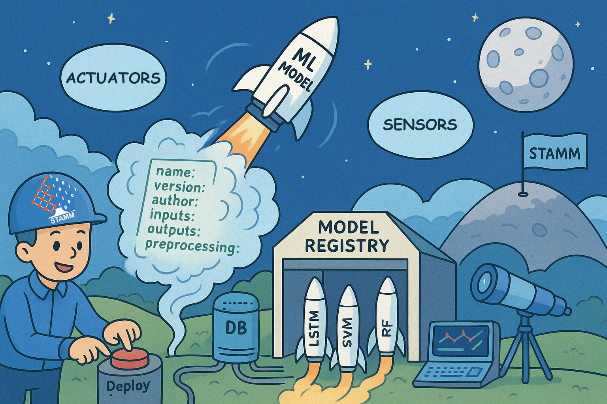

STAMM Model Registry
====================

Documentation for the STAMM Model Registry.

The Model Registry is a core component of the STAMM platform responsible
for managing machine learning models, their metadata and artifacts, and
providing access through a REST API.

Contents
--------

* :doc:`What is the Model Registry? <overview/index>`

  * :doc:`Architecture <overview/architecture>`

* :doc:`Getting Started <getting-started/index>`

  * :doc:`Installation and Deployment <getting-started/installation>`

* **For developers**

  * :doc:`API <api/index>`

    * :doc:`API Reference <api/api-reference>`

    * :doc:`Authentication and Permissions <api/authentication-permissions>`

    * :doc:`Authentication Flow <api/auth-flow>`

    * :doc:`Model Retrieval Flow <api/model-retrieval-flow>`

    * :doc:`Request and Response Examples <api/request-response-examples>`

  * :doc:`Database <database/index>`

    * :ref:`Database Overview <database-overview>`

* :doc:`For users <for-users/index>`

  * :doc:`ML Soft Sensors <for-users/ml-soft-sensors/index>`

    * :doc:`CRUD Operations <for-users/ml-soft-sensors/crud>`

    * :doc:`Model Explainability (XAI) <for-users/ml-soft-sensors/xai>`

    * :doc:`Other Soft Sensor Functionalities <for-users/ml-soft-sensors/other-functionalities>`

  * :doc:`Drift Detectors <for-users/drift-detectors/index>`

.. toctree::
   :hidden:
   :maxdepth: 4
   :includehidden:

   overview/index
   getting-started/index
   api/index
   database/index
   for-users/index
